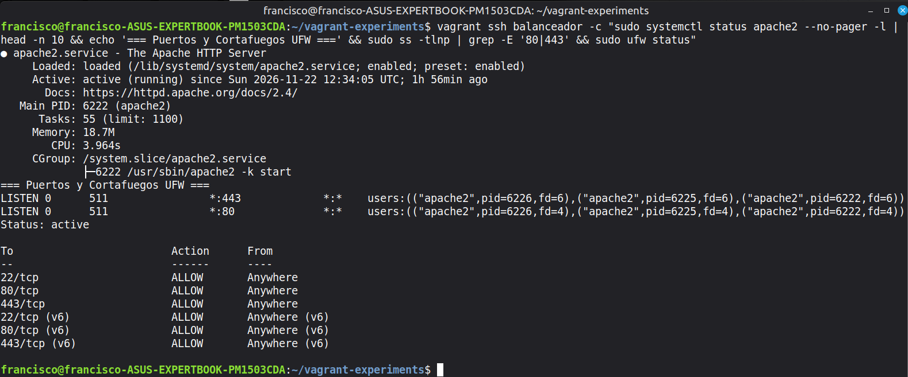
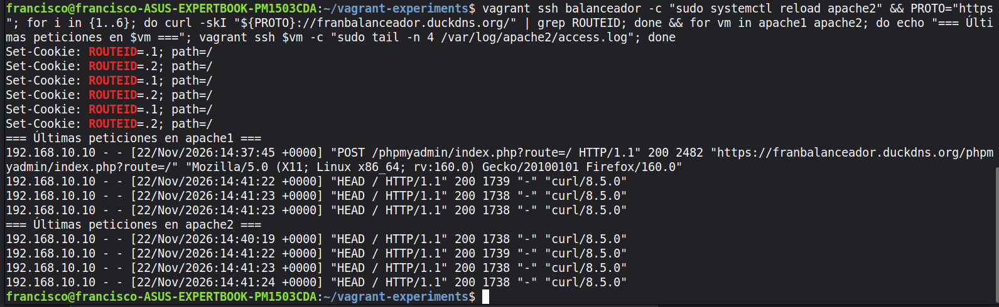
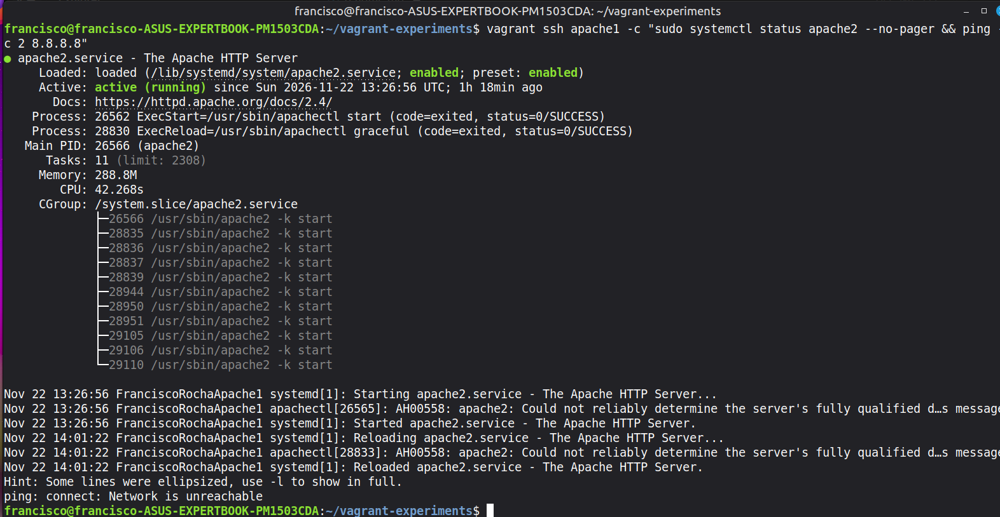
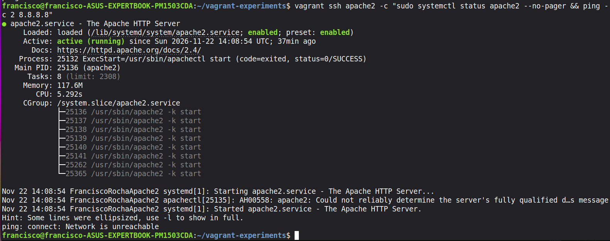
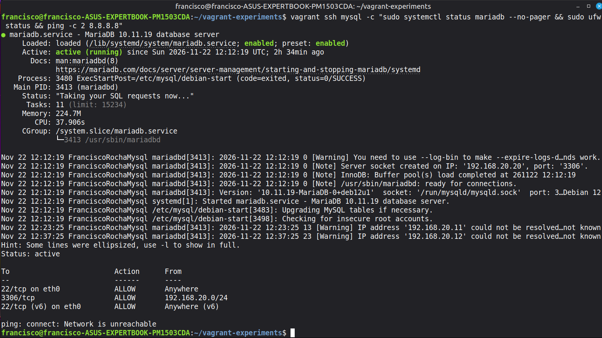
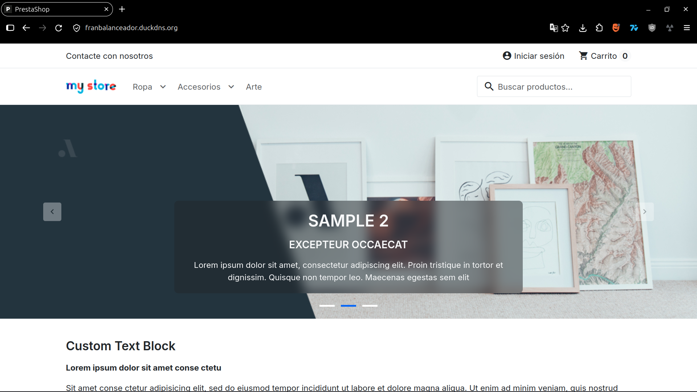
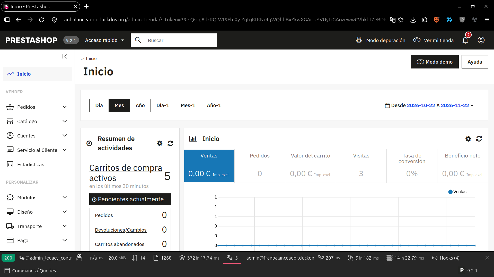
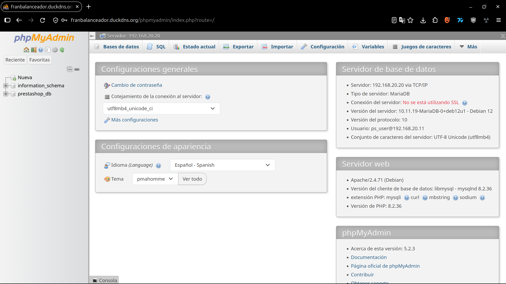

# -Instalar-Prestashop
# Despliegue Automatizado de PrestaShop 9.2.1 con HTTPS y Alta Disponibilidad en 3 Capas

Este documento detalla la infraestructura basada en **Debian 12 (Bookworm)** y **Vagrant** para desplegar una aplicación web en tres capas segmentadas por redes internas aisladas (`red_capa1_capa2` y `red_capa2_capa3`), así como los scripts modulares de aprovisionamiento para **PrestaShop 9.2.1**, **phpMyAdmin** y **SSL/TLS con Let's Encrypt**.

---

## 1. Arquitectura de la Infraestructura (3 Capas)

- **Capa 1 — Balanceador (`balanceador` - `192.168.10.10`):** Proxy inverso Apache (`mod_proxy_balancer`) con HTTPS forzado, terminación SSL/TLS mediante certificado real de **Let's Encrypt** (validación DNS-01 con DuckDNS), persistencia de sesiones mediante cookie `ROUTEID` y cortafuegos `ufw`.
- **Capa 2 — Servidores Web (`apache1` - `192.168.10.11` / `192.168.20.11` y `apache2` - `192.168.10.12` / `192.168.20.12`):** Clúster activo-activo de nodos Apache + PHP 8.2 que alojan **PrestaShop 9.2.1** y **phpMyAdmin 5.2.3**, configurados con detección de HTTPS tras proxy (`X-Forwarded-Proto`) y aislados sin salida directa a Internet tras el aprovisionamiento.
- **Capa 3 — Base de Datos (`mysql` - `192.168.20.20`):** Servidor MariaDB dedicado y protegido en red privada con `ufw`, aceptando conexiones únicamente desde la subred de Capa 2 (`192.168.20.0/24`) en el puerto `3306`.

---

## 2. Proceso de Instalación de PrestaShop 9.2.1

El despliegue de la aplicación se realiza de forma desatendida mediante el script `pprestashop.sh` en las siguientes fases:

1. **Preparación del Entorno (PHP 8.2, Composer y Node.js):** Instalación de las extensiones requeridas por PrestaShop (`curl`, `gd`, `intl`, `mbstring`, `xml`, `zip`, `bcmath`, `imagick`, `mysql`), gestor de dependencias Composer y Node.js 24 LTS. Ajuste de directivas en `php.ini` (`memory_limit = 512M`, `max_input_vars = 5000`).
2. **Configuración de Apache y SSL tras Proxy:** Habilitación de `mod_rewrite`, activación de archivos `.htaccess` (`AllowOverride All`) y configuración de `SetEnvIf X-Forwarded-Proto "https" HTTPS=on` para que PrestaShop reconozca el tráfico cifrado proveniente del balanceador.
3. **Descarga y Compilación de Código Fuente (Nodo `apache1`):** Descarga de PrestaShop 9.2.1 desde GitHub, instalación de librerías PHP con `composer install` y compilación de activos estáticos (CSS/JS) de temas y módulos mediante `npm run build`.
4. **Instalación Desatendida (CLI):** Ejecución de `install-dev/index_cli.php` conectando con la base de datos `prestashop_db` en la Capa 3 (`192.168.20.20`), configurando el dominio HTTPS (`franbalanceador.duckdns.org`), idioma español y credenciales de administración.
5. **Post-instalación, Seguridad y phpMyAdmin:** Aplicación de parche en traducciones `es-ES` para PHP 8.2, eliminación del instalador (`install-dev`), renombrado del panel de administración (`admin_tienda`) y despliegue de **phpMyAdmin** apuntando al servidor MariaDB.
6. **Sincronización del Clúster (Nodo `apache2`) y Aislamiento:** Empaquetado de la instalación completa en `/vagrant/ps_instalado.tar.gz` para replicarla de forma idéntica en `apache2` y eliminación de la puerta de enlace por defecto para aislar los servidores web de Internet.


## Índice

- [Verificación del Sistema (Capturas de Pantalla)](#verificación-del-sistema-capturas-de-pantalla)
  - [1. Servidor de Balanceo de Carga y SSL (`balanceador`)](#1-servidor-de-balanceo-de-carga-y-ssl-balanceador)
  - [2. Servidores Web (`apache1` y `apache2`)](#2-servidores-web-apache1-y-apache2)
  - [3. Servidor de Base de Datos (`mysql`)](#3-servidor-de-base-de-datos-mysql)
  - [4. PrestaShop en funcionamiento y phpMyAdmin](#4-prestashop-en-funcionamiento-y-phpmyadmin)
  - [Screencast con la aplicación desplegada](#screencast-con-la-aplicación-desplegada)
- [Scripts de Aprovisionamiento Explicados](#scripts-de-aprovisionamiento-explicados)
  - [1. Script del Servidor Web (`papache.sh`)](#1-script-del-servidor-web-papachesh)
  - [2. Script del Servidor de Base de datos (`pmysql.sh`)](#2-script-del-servidor-de-base-de-datos-pmysqlsh)
  - [3. Script del Balanceador (`pbalanceador.sh`)](#3-script-del-balanceador-pbalanceadorsh)
  - [4. Script de Despliegue de PrestaShop (`pprestashop.sh`)](#4-script-de-despliegue-de-prestashop-pprestashopsh)


## Verificación del Sistema (Capturas de Pantalla)

### 1. Servidor de Balanceo de Carga y SSL (`balanceador`)



### 2. Servidores Web (`apache1` y `apache2`)



### 3. Servidor de Base de Datos (`mysql`)


### 4. PrestaShop en funcionamiento y phpMyAdmin





### Screencast con la aplicación desplegada
A continuación se muestra la grabación de pantalla que demuestra el correcto funcionamiento de la aplicación web interactuando con la base de datos:

https://github.com/user-attachments/assets/274c4069-96b2-4eb6-ac14-4cd3ef474051

##  Scripts de Aprovisionamiento Explicados

A continuación se desglosan los comandos utilizados en la automatización junto con la explicación detallada de cada orden.

###  1. Script del Servidor Web (`papache.sh`)
```bash
#!/bin/bash
# Fuerza al script a detenerse inmediatamente si ocurre algún error durante la ejecución.
set -e

# Configura las instalaciones de apt para que sean automáticas y no soliciten confirmaciones al usuario.
export DEBIAN_FRONTEND=noninteractive

# Actualiza el índice de paquetes locales con las últimas versiones de los repositorios.
apt-get update -y

# Instala el servidor web Apache, PHP, el módulo conector, el driver de MySQL para PHP y la herramienta Git.
apt-get install -y apache2 php libapache2-mod-php php-mysql git

# Limpia por completo el directorio raíz del servidor web eliminando el archivo index.html por defecto.
rm -rf /var/www/html/*

# Se desplaza al directorio temporal del sistema para trabajar de forma aislada.
cd /tmp

# Elimina cualquier rastro previo del repositorio de la práctica si existiera.
rm -rf iaw-practica-lamp

# Clona el repositorio con el código fuente de la aplicación web desde GitHub de forma local.
git clone https://github.com/josejuansanchez/iaw-practica-lamp.git

# Copia de forma recursiva todos los archivos de código PHP de la aplicación al directorio de Apache.
cp -r /tmp/iaw-practica-lamp/src/* /var/www/html/

# Reemplaza la constante DB_HOST en el archivo de configuración para apuntar a la nueva IP del servidor de datos (192.168.20.20).
sed -i "s/define('DB_HOST', '.*');/define('DB_HOST', '192.168.20.20');/" /var/www/html/config.php

# Reemplaza el nombre de la base de datos objetivo con 'lamp_db'.
sed -i "s/define('DB_NAME', '.*');/define('DB_NAME', 'lamp_db');/" /var/www/html/config.php

# Reemplaza el usuario que se conectará con el nombre de usuario configurado 'lamp_user'.
sed -i "s/define('DB_USER', '.*');/define('DB_USER', 'lamp_user');/" /var/www/html/config.php

# Reemplaza la contraseña de conexión por la credencial compartida 'password_seguro'.
sed -i "s/define('DB_PASSWORD', '.*');/define('DB_PASSWORD', 'password_seguro');/" /var/www/html/config.php

# Cambia el propietario de los archivos web al usuario 'www-data' (el de Apache) para otorgar permisos de lectura/escritura correctos.
chown -R www-data:www-data /var/www/html/

# Reinicia el servicio de Apache para aplicar la configuración de PHP y cargar la aplicación limpiamente.
systemctl restart apache2

# Elimina la ruta por defecto (puerta de enlace) para cortar el acceso a Internet en la sesión actual sin desconectar el SSH de Vagrant.
ip route del default || true

# Crea un script en el directorio 'if-up.d' para que la ruta por defecto se elimine automáticamente cada vez que se levante la red tras un reinicio.
cat << 'EOF' > /etc/network/if-up.d/sin-internet
#!/bin/sh
ip route del default 2>/dev/null || true
EOF

# Otorga permisos de ejecución al script para asegurar que el sistema lo aplique en cada arranque.
chmod +x /etc/network/if-up.d/sin-internet

```

###  2. Script del Servidor de Base de datos (`pmysql.sh`)
```bash
#!/bin/bash
# Fuerza al script a detenerse inmediatamente si ocurre algún error.
set -e
# Configura las instalaciones de apt en modo no interactivo.
export DEBIAN_FRONTEND=noninteractive

# Actualiza los repositorios locales.
apt-get update -y
# Instala el servidor de bases de datos MariaDB, Git y el cortafuegos UFW.
apt-get install -y mariadb-server git ufw

# Modifica la configuración de MariaDB para que escuche peticiones en la IP privada de la red de datos.
sed -i 's/^bind-address.*/bind-address = 192.168.20.20/' /etc/mysql/mariadb.conf.d/50-server.cnf
# Reinicia el servicio MariaDB para aplicar el cambio de interfaz de red.
systemctl restart mariadb

# Crea la base de datos para la práctica LAMP si no existe previamente.
mysql -e "CREATE DATABASE IF NOT EXISTS lamp_db;"
# Crea el usuario 'lamp_user' permitiéndole conectarse únicamente desde la subred 192.168.20.x.
mysql -e "CREATE USER IF NOT EXISTS 'lamp_user'@'192.168.20.%' IDENTIFIED BY 'password_seguro';"
# Otorga todos los privilegios sobre 'lamp_db' al usuario 'lamp_user'.
mysql -e "GRANT ALL PRIVILEGES ON lamp_db.* TO 'lamp_user'@'192.168.20.%';"

# Crea la base de datos para PrestaShop con soporte completo de caracteres UTF-8.
mysql -e "CREATE DATABASE IF NOT EXISTS prestashop_db CHARACTER SET utf8mb4 COLLATE utf8mb4_unicode_ci;"
# Crea el usuario 'ps_user' restringido a conexiones desde la subred 192.168.20.x.
mysql -e "CREATE USER IF NOT EXISTS 'ps_user'@'192.168.20.%' IDENTIFIED BY 'password_seguro';"
# Otorga todos los privilegios sobre 'prestashop_db' al usuario 'ps_user'.
mysql -e "GRANT ALL PRIVILEGES ON prestashop_db.* TO 'ps_user'@'192.168.20.%';"

# Recarga las tablas de permisos en MariaDB para que los nuevos usuarios surtan efecto de inmediato.
mysql -e "FLUSH PRIVILEGES;"

# Se desplaza al directorio temporal del sistema.
cd /tmp
# Elimina cualquier copia previa del repositorio de la práctica.
rm -rf iaw-practica-lamp
# Clona el repositorio de GitHub que contiene el esquema SQL de la práctica LAMP.
git clone https://github.com/josejuansanchez/iaw-practica-lamp.git
# Importa las tablas y datos iniciales dentro de la base de datos 'lamp_db'.
mysql lamp_db < /tmp/iaw-practica-lamp/db/database.sql

# Establece la política por defecto del cortafuegos para denegar conexiones entrantes.
ufw default deny incoming
# Establece la política por defecto para permitir conexiones salientes.
ufw default allow outgoing
# Permite el acceso SSH (puerto 22) únicamente a través de la interfaz de administración eth0 (Vagrant).
ufw allow in on eth0 to any port 22 proto tcp
# Permite el acceso al puerto de MySQL (3306) únicamente desde los servidores de la red de capa 2/3 (192.168.20.0/24).
ufw allow from 192.168.20.0/24 to any port 3306 proto tcp
# Activa el cortafuegos UFW sin solicitar confirmación.
ufw --force enable

# Elimina la ruta por defecto para aislar el servidor de Internet en la sesión actual.
ip route del default || true

# Crea un script de red para eliminar la puerta de enlace automáticamente cada vez que arranque el sistema.
cat << 'EOF' > /etc/network/if-up.d/sin-internet
#!/bin/sh
ip route del default 2>/dev/null || true
EOF
# Otorga permisos de ejecución al script de aislamiento de red.
chmod +x /etc/network/if-up.d/sin-internet


```

###  3. Script del Balanceador (`pbalanceador.sh`)
```bash
#!/bin/bash
# Fuerza al script a detenerse inmediatamente si ocurre algún error durante la ejecución.
set -e

# Define la variable con el nombre de dominio dinámico registrado en DuckDNS.
DOMINIO="franbalanceador.duckdns.org"
# Define el token de autenticación privado de la cuenta de DuckDNS.
TOKEN_DUCKDNS="ejemplo tomken"
# Define el correo electrónico asociado al registro del certificado SSL.
EMAIL="ejemplo.com"

# Configura las instalaciones de apt para que sean automáticas y no soliciten confirmaciones.
export DEBIAN_FRONTEND=noninteractive
# Actualiza el índice de paquetes locales con las últimas versiones de los repositorios.
apt-get update -y
# Instala el servidor web Apache, el cliente Certbot y el gestor de paquetes de Python.
apt-get install -y apache2 certbot python3-pip
# Instala el plugin de Certbot para DuckDNS permitiendo modificar paquetes del sistema.
pip3 install certbot-dns-duckdns --break-system-packages

# Habilita los módulos de Apache necesarios para proxy inverso, balanceo de carga, SSL y cabeceras.
a2enmod proxy proxy_http proxy_balancer lbmethod_byrequests ssl headers

# Solicita un certificado SSL válido a Let's Encrypt mediante validación DNS automatizada con DuckDNS.
certbot certonly \
  --non-interactive \
  --agree-tos \
  --email "$EMAIL" \
  --preferred-challenges dns \
  --authenticator dns-duckdns \
  --dns-duckdns-token "$TOKEN_DUCKDNS" \
  --dns-duckdns-propagation-seconds 60 \
  -d "$DOMINIO"

# Sobrescribe el archivo de configuración del sitio por defecto de Apache con los VirtualHosts HTTP y HTTPS.
cat <<EOF > /etc/apache2/sites-available/000-default.conf
# Abre el bloque de configuración para el tráfico web sin cifrar en el puerto 80.
<VirtualHost *:80>
    # Especifica el nombre de dominio al que responde este bloque.
    ServerName $DOMINIO
    # Redirige de forma permanente todo el tráfico HTTP hacia su versión segura HTTPS.
    Redirect permanent / https://$DOMINIO/
# Cierra el bloque VirtualHost del puerto 80.
</VirtualHost>

# Abre el bloque de configuración para el tráfico seguro HTTPS en el puerto 443.
<VirtualHost *:443>
    # Especifica el nombre de dominio al que responde este bloque.
    ServerName $DOMINIO
    # Define el correo de contacto del administrador del servidor.
    ServerAdmin webmaster@localhost

    # Activa el motor de cifrado SSL/TLS en este sitio.
    SSLEngine on
    # Indica la ruta al certificado público generado por Let's Encrypt.
    SSLCertificateFile /etc/letsencrypt/live/$DOMINIO/fullchain.pem
    # Indica la ruta a la clave privada del certificado SSL.
    SSLCertificateKeyFile /etc/letsencrypt/live/$DOMINIO/privkey.pem

    # Añade una cabecera HTTP para informar a los servidores internos de que la petición original llegó por HTTPS.
    RequestHeader set X-Forwarded-Proto "https"

    # Crea o actualiza una cookie llamada ROUTEID para mantener la sesión del usuario pegada al mismo servidor web.
    Header add Set-Cookie "ROUTEID=.%{BALANCER_WORKER_ROUTE}e; path=/" env=BALANCER_ROUTE_CHANGED
    # Define el grupo o clúster de servidores backend que recibirán el tráfico balanceado.
    <Proxy "balancer://micluster">
        # Añade el primer servidor web interno (apache1) asignándole la ruta 1.
        BalancerMember http://192.168.10.11 route=1
        # Añade el segundo servidor web interno (apache2) asignándole la ruta 2.
        BalancerMember http://192.168.10.12 route=2
        # Configura el reparto equitativo por número de peticiones y activa la persistencia mediante la cookie ROUTEID.
        ProxySet lbmethod=byrequests stickysession=ROUTEID
    # Cierra la definición del clúster de balanceo.
    </Proxy>

    # Mantiene la cabecera Host original del cliente al reenviar la petición a los servidores internos.
    ProxyPreserveHost On
    # Redirige todas las peticiones entrantes de la raíz hacia el clúster balanceado.
    ProxyPass / balancer://micluster/
    # Ajusta las cabeceras de respuesta de los servidores internos para que coincidan con la URL del balanceador.
    ProxyPassReverse / balancer://micluster/

    # Define la ruta del archivo de registro de errores de Apache.
    ErrorLog \${APACHE_LOG_DIR}/error.log
    # Define la ruta y el formato del archivo de registro de accesos.
    CustomLog \${APACHE_LOG_DIR}/access.log combined
# Cierra el bloque VirtualHost del puerto 443.
</VirtualHost>
# Finaliza la escritura del archivo de configuración de Apache.
EOF

# Verifica que la sintaxis de los archivos de configuración de Apache no tenga errores.
apache2ctl configtest
# Reinicia el servicio de Apache para aplicar los nuevos certificados y reglas de balanceo.
systemctl restart apache2

# Instala el cortafuegos UFW (Uncomplicated Firewall).
apt-get install -y ufw
# Bloquea por defecto todo el tráfico entrante hacia el balanceador.
ufw default deny incoming
# Permite por defecto todo el tráfico saliente desde el balanceador.
ufw default allow outgoing
# Permite las conexiones entrantes por SSH (puerto 22).
ufw allow 22/tcp
# Permite el tráfico web HTTP entrante (puerto 80).
ufw allow 80/tcp
# Permite el tráfico web seguro HTTPS entrante (puerto 443).
ufw allow 443/tcp
# Activa el cortafuegos de forma forzada sin pedir confirmación interactiva.
ufw --force enable
```

###  4. Script de Despliegue de PrestaShop (pprestashop.sh)

```bash
#!/bin/bash
# Detiene el script si ocurre cualquier fallo.
set -e
# Evita preguntas interactivas durante la instalación de paquetes.
export DEBIAN_FRONTEND=noninteractive

# Actualiza el listado de paquetes de los repositorios.
apt-get update -y
# Instala utilidades básicas, Composer y todas las extensiones de PHP 8.2 requeridas por PrestaShop.
apt-get install -y ca-certificates curl gnupg unzip git composer \
  php8.2-curl php8.2-gd php8.2-intl php8.2-mbstring php8.2-xml php8.2-zip php8.2-bcmath php8.2-imagick php8.2-mysql

# Descarga y configura el repositorio oficial de NodeSource para Node.js 24.
curl -fsSL https://deb.nodesource.com/setup_24.x | bash -
# Instala Node.js y el gestor de paquetes npm.
apt-get install -y nodejs

# Inicia un bucle para modificar los archivos de configuración de PHP tanto para Apache como para la terminal (CLI).
for INI in /etc/php/8.2/apache2/php.ini /etc/php/8.2/cli/php.ini; do
  # Aumenta el límite máximo de variables de entrada permitidas a 5000.
  sed -i 's/^;*max_input_vars.*/max_input_vars = 5000/' "$INI"
  # Aumenta el límite de memoria por script PHP a 512 MB.
  sed -i 's/^;*memory_limit.*/memory_limit = 512M/' "$INI"
  # Aumenta el tamaño máximo de datos enviados por POST a 128 MB.
  sed -i 's/^;*post_max_size.*/post_max_size = 128M/' "$INI"
  # Aumenta el tamaño máximo permitido para subir archivos a 128 MB.
  sed -i 's/^;*upload_max_filesize.*/upload_max_filesize = 128M/' "$INI"
# Finaliza el bucle de configuración de PHP.
done

# Activa los módulos de Apache para URLs amigables (rewrite), cabeceras y variables de entorno.
a2enmod rewrite headers setenvif
# Permite el uso de archivos .htaccess en el directorio /var/www/ cambiando AllowOverride a All.
sed -i '/<Directory \/var\/www\/>/,/<\/Directory>/ s/AllowOverride None/AllowOverride All/' /etc/apache2/apache2.conf
# Crea una regla para que PHP detecte que la conexión es HTTPS cuando llega la cabecera desde el balanceador.
echo 'SetEnvIf X-Forwarded-Proto "https" HTTPS=on' > /etc/apache2/conf-available/proxy-ssl.conf
# Habilita la nueva configuración de detección de proxy SSL en Apache.
a2enconf proxy-ssl
# Reinicia Apache para aplicar todos los cambios de módulos y configuración.
systemctl restart apache2

# Comprueba si el script se ejecutó con el argumento "instalar" (solo ocurre en el servidor apache1).
if [ "$1" = "instalar" ]; then
  # Cambia al directorio temporal.
  cd /tmp
  # Borra descargas o carpetas anteriores de PrestaShop si existen.
  rm -rf 9.2.1.zip PrestaShop-9.2.1
  # Descarga el archivo ZIP con el código fuente de PrestaShop 9.2.1 desde GitHub.
  curl -fL -o 9.2.1.zip https://github.com/PrestaShop/PrestaShop/archive/refs/tags/9.2.1.zip
  # Descomprime el archivo descargado en modo silencioso.
  unzip -q 9.2.1.zip

  # Vacía por completo el directorio web (incluyendo archivos ocultos).
  rm -rf /var/www/html/* /var/www/html/.[!.]*
  # Copia todos los archivos de PrestaShop al directorio raíz del servidor web.
  cp -r /tmp/PrestaShop-9.2.1/. /var/www/html/
  # Asigna la propiedad de todos los archivos al usuario y grupo de Apache (www-data).
  chown -R www-data:www-data /var/www/html/

  # Entra en el directorio raíz de la web.
  cd /var/www/html
  # Instala las dependencias de PHP mediante Composer ejecutándose como usuario www-data sin límite de memoria.
  sudo -u www-data HOME=/tmp COMPOSER_ALLOW_SUPERUSER=1 php -d memory_limit=-1 /usr/bin/composer install --no-dev --optimize-autoloader

  # Busca todos los archivos package.json (excluyendo librerías externas y tests) para compilar temas y módulos.
  find /var/www/html -maxdepth 4 -name "package.json" \
    -not -path "*/vendor/*" \
    -not -path "*/node_modules/*" \
    -not -path "*/tests/*" | while read -r pkg; do
      # Extrae la ruta del directorio donde se encuentra cada package.json.
      DIR=$(dirname "$pkg")
      # Muestra por pantalla qué directorio se está compilando.
      echo "Compilando assets en: $DIR"
      # Entra en dicho directorio.
      cd "$DIR"
      # Instala las dependencias de JavaScript con npm.
      sudo -u www-data HOME=/tmp npm install --no-audit --no-fund
      # Compila los archivos estáticos (CSS/JS) usando soporte legacy de OpenSSL si es necesario.
      sudo -u www-data HOME=/tmp NODE_OPTIONS=--openssl-legacy-provider npm run build || true
  # Finaliza el bucle de compilación de assets.
  done

  # Regresa al directorio raíz de PrestaShop.
  cd /var/www/html

  # Ejecuta el instalador automático de PrestaShop por línea de comandos pasando dominio, BD, idioma y credenciales.
  sudo -u www-data php -d memory_limit=-1 /var/www/html/install-dev/index_cli.php \
    --domain=franbalanceador.duckdns.org \
    --db_server=192.168.20.20 \
    --db_name=prestashop_db \
    --db_user=ps_user \
    --db_password=password_seguro \
    --prefix=ps_ \
    --language=es \
    --country=es \
    --timezone=Europe/Madrid \
    --ssl=1 \
    --rewrite=1 \
    --email=admin@franbalanceador.duckdns.org \
    --password=AdminPassword123 \
    --firstname=Admin \
    --lastname=Tienda

  # Corrige un error en las traducciones al español escapando símbolos de porcentaje sueltos para evitar fallos en PHP 8.2.
  find /var/www/html/translations/es-ES /var/www/html/themes/hummingbird/translations/es-ES \
    -type f -name '*.xlf' \
    -exec sed -i -E 's/%([^sdfbcdeEfFgGhHoOxXu%])/%%\1/g; s/%$/%%/g' {} + 2>/dev/null || true

  # Elimina la carpeta de instalación por seguridad y limpia la caché generada.
  rm -rf /var/www/html/install-dev /var/www/html/admin_tienda /var/www/html/var/cache/*
  # Renombra la carpeta de administración por defecto a 'admin_tienda'.
  mv /var/www/html/admin-dev /var/www/html/admin_tienda

  # Se desplaza al directorio temporal para descargar phpMyAdmin.
  cd /tmp
  # Descarga la última versión multilenguaje de phpMyAdmin.
   curl -fsSL -o phpMyAdmin.tar.gz https://www.phpmyadmin.net/downloads/phpMyAdmin-latest-all-languages.tar.gz
  # Crea el directorio destino para phpMyAdmin dentro de la web.
  mkdir -p /var/www/html/phpmyadmin
  # Extrae el contenido de phpMyAdmin eliminando la carpeta raíz del archivo comprimido.
  tar -xzf phpMyAdmin.tar.gz --strip-components=1 -C /var/www/html/phpmyadmin
  # Elimina el archivo comprimido descargado.
  rm -f phpMyAdmin.tar.gz

  # Genera una clave aleatoria segura de 24 bytes para el cifrado de cookies de phpMyAdmin.
  BLOWFISH=$(openssl rand -base64 24)
  # Crea el archivo de configuración de phpMyAdmin apuntando al servidor MariaDB de la capa 3.
  cat <<PMAEOF > /var/www/html/phpmyadmin/config.inc.php
<?php
\$cfg['blowfish_secret'] = '$BLOWFISH';
\$i = 1;
\$cfg['Servers'][\$i]['auth_type'] = 'cookie';
\$cfg['Servers'][\$i]['host'] = '192.168.20.20';
\$cfg['Servers'][\$i]['AllowNoPassword'] = false;
PMAEOF

  # Crea el directorio temporal interno que requiere phpMyAdmin.
  mkdir -p /var/www/html/phpmyadmin/tmp
  # Asigna permisos de propiedad a Apache sobre toda la carpeta de phpMyAdmin.
  chown -R www-data:www-data /var/www/html/phpmyadmin

  # Empaqueta y comprime toda la tienda ya instalada en la carpeta compartida /vagrant para que apache2 la copie.
  tar -czf /vagrant/ps_instalado.tar.gz -C /var/www/html .
# Si el argumento no es "instalar" (caso del servidor secundario apache2):
else
  # Borra cualquier archivo previo en el directorio web.
  rm -rf /var/www/html/* /var/www/html/.[!.]*
  # Descomprime la copia exacta de PrestaShop ya instalada desde la carpeta compartida /vagrant.
  tar -xzf /vagrant/ps_instalado.tar.gz -C /var/www/html
  # Asigna la propiedad de los archivos extraídos al usuario www-data.
  chown -R www-data:www-data /var/www/html/
# Cierra la estructura condicional if-else.
fi

# Elimina la puerta de enlace por defecto para cortar la salida a Internet en la sesión actual.
ip route del default || true
# Crea el script persistente en if-up.d para mantener el servidor aislado tras reinicios.
cat << 'NETEOF' > /etc/network/if-up.d/sin-internet
#!/bin/sh
ip route del default 2>/dev/null || true
NETEOF
# Otorga permisos de ejecución al script de aislamiento de red.
chmod +x /etc/network/if-up.d/sin-internet
